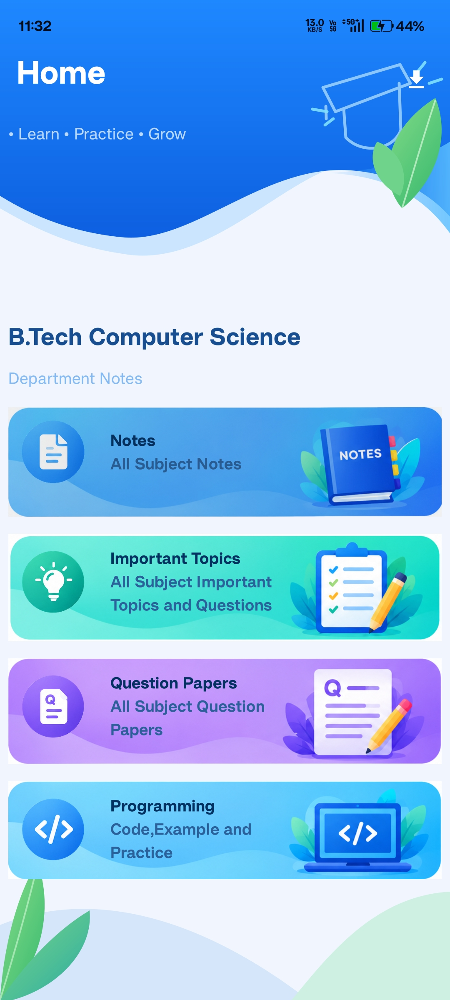

# MrBTech – Android Learning Application

MrBTech is an Android application designed to help students access academic learning materials in one place. It provides subject-wise learning resources, important notes, question papers, programming resources, and PDF downloads.

The application is developed using **Kotlin and Jetpack Compose**, following the MVVM architecture and Repository pattern.

## ✨ Features

- **Department & Semester Selection** – Select academic information to access relevant learning materials.
- **Subjects** – Browse subjects based on department and semester.
- **Units** – Access unit-wise learning resources.
- **Important Notes** – Find important subject-wise notes and study materials.
- **Question Papers** – Access question papers for different subjects.
- **PDF Downloads** – Download and manage study materials.
- **Programming Resources** – Access programming-related learning content.

## 📱 Screenshots

Add your actual application screenshots inside the `screenshots/` folder.

| Home Screen | Subject Screen |
|---|---|
|  |  |

| Important Notes | Question Papers |
|---|---|
|  |  |

## 🛠️ Tech Stack

- **Language:** Kotlin
- **UI:** Jetpack Compose
- **Architecture:** MVVM
- **Asynchronous Programming:** Kotlin Coroutines
- **State Management:** StateFlow
- **Backend:** Firebase Firestore
- **Dependency Injection:** Hilt
- **File Downloads:** Android DownloadManager
- **Navigation:** Navigation Compose

## 🏗️ Architecture

The application follows a layered architecture with MVVM.

```text
app/
├── data/
│   ├── remote/
│   ├── downloader/
│   └── repository/
│
├── domain/
│   ├── model/
│   └── repository/
│
├── presentation/
│   ├── home_screen/
│   ├── subject_screen/
│   ├── unit_screen/
│   ├── important_notes/
│   ├── question_paper/
│   ├── downloaded_pdf/
│   └── navigation/
│
├── di/
├── ui/
└── util/
```

### Architecture responsibilities

- **Presentation:** Manages UI components, ViewModels, UI states and user events.
- **Domain:** Contains application models and repository contracts.
- **Data:** Handles Firebase data access, repository implementations and downloads.
- **Dependency Injection:** Uses Hilt to provide dependencies.

## 🚀 Getting Started

### Prerequisites

- Android Studio
- Kotlin
- Android SDK
- Firebase project

### Installation

1. Clone the repository:

```bash
git clone https://github.com/YOUR_USERNAME/MrBTech.git
```

2. Open the project in Android Studio.

3. Configure Firebase:
   - Create or select your Firebase project.
   - Register your Android application using its actual application ID.
   - Add your own `google-services.json` inside the `app/` directory.
   - Enable and configure Cloud Firestore.
   - Configure appropriate Firestore security rules.

4. Sync Gradle.

5. Run the application on an emulator or Android device.

## 🔐 Security

Firebase configuration and access permissions must be configured for your own Firebase project.

Never commit Firebase service-account credentials, private keys, signing keys or other secrets. Review Firestore security rules before making the project public.

## 🔮 Future Improvements

- Add automated unit tests.
- Improve download progress tracking.
- Improve error handling and offline support.
- Add more learning resources.
- Improve UI accessibility.

## 👨‍💻 Developer

**Sabarivasan**

Aspiring Android Developer | Kotlin | Jetpack Compose

GitHub: https://github.com/sabari1812


---

If you find this project useful, feel free to explore the repository and share your feedback.
